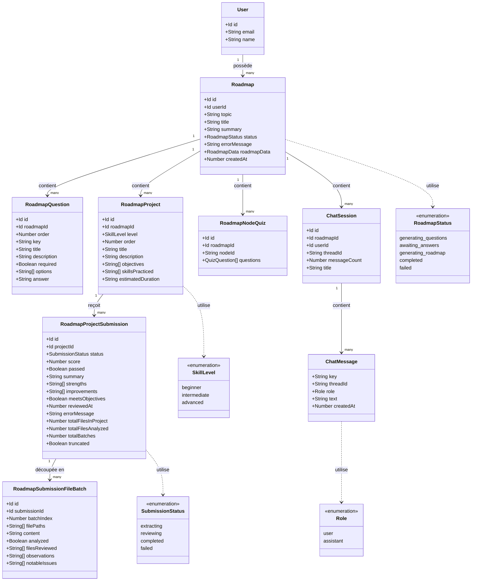

# AI Roadmap Generator

Application web permettant à n'importe quel utilisateur de générer, via l'IA, une roadmap d'apprentissage personnalisée sur le sujet de son choix, puis de progresser dedans grâce à un assistant conversationnel, des quiz de validation et des projets pratiques évalués automatiquement.

> Assisant AI pour les étudiants 

## Table des matières

- [Aperçu](#aperçu)
- [Fonctionnalités](#fonctionnalités)
- [Stack technique](#stack-technique)
- [Architecture](#architecture)
  - [Génération de la roadmap](#génération-de-la-roadmap)
  - [Visualisation](#visualisation)
  - [Assistant conversationnel](#assistant-conversationnel)
  - [Quiz par nœud](#quiz-par-nœud)
  - [Projets pratiques et revue automatique](#projets-pratiques-et-revue-automatique)
- [Structure du projet](#structure-du-projet)
- [Prérequis](#prérequis)
- [Installation](#installation)
- [Variables d'environnement](#variables-denvironnement)
- [Lancer le projet en local](#lancer-le-projet-en-local)
- [Modèle de données](#modèle-de-données)
- [Limites connues](#limites-connues)
- [Feuille de route du projet](#feuille-de-route-du-projet)
- [Contribuer](#contribuer)
- [Licence](#licence)

## Aperçu

L'utilisateur indique un sujet qu'il souhaite apprendre. L'application génère dynamiquement, via un modèle de langage, une série de questions de cadrage (niveau, objectif, ressources d'apprentissage préférées, etc.), puis construit à partir des réponses une roadmap structurée sous forme de diagramme interactif. Chaque nœud de la roadmap peut ensuite être exploré à l'aide d'un tuteur IA conversationnel adapté au profil de l'utilisateur, validé par un quiz généré automatiquement, et complété par un projet pratique dont le rendu est analysé et noté par l'IA.

## Fonctionnalités

- Génération dynamique de questions de cadrage par IA, adaptées au sujet demandé
- Génération d'une roadmap structurée sous forme de diagramme (Mermaid) à partir des réponses de l'utilisateur
- Diagramme interactif avec zoom, déplacement (pan) et nœuds verrouillés/déverrouillés selon la progression
- Assistant IA conversationnel par roadmap, avec limite d'échanges par discussion et création de nouvelles discussions
- Historique des discussions consultable dans une barre latérale dédiée
- Génération automatique du titre d'une discussion après le premier échange
- Quiz généré par IA pour valider la compréhension de chaque nœud avant de le marquer comme acquis
- Projets pratiques par niveau de compétence, avec soumission de code et revue automatique par lots de fichiers
- Extraction et analyse de contenu externe (scraping) pour enrichir la génération de contenu
- Adaptation du contenu généré au profil déclaré par l'utilisateur (langage, niveau, ressource d'apprentissage préférée, etc.)
- Interface responsive avec adaptation mobile dédiée (navigation par onglets) et disposition en panneaux redimensionnables sur desktop

## Stack technique

**Frontend**
- Next.js (App Router) et React
- TypeScript
- Tailwind CSS
- shadcn/ui (composants `Field`, `Sidebar`, `Resizable`, `MessageScroller`, etc.)
- Zustand pour l'état client (sélection de nœud, session de chat active, UI des quiz)
- `@xyflow/react` pour le rendu du diagramme de roadmap
- Rendu Mermaid personnalisé avec zoom/pan via transformation CSS

**Backend**
- Convex comme backend temps réel (base de données, fonctions serveur, planification de tâches)
- `@convex-dev/agent` pour la gestion des threads de conversation IA et la persistance des messages
- Better Auth pour l'authentification
- Composant `convex-firecrawl-scrape` pour le scraping de contenu, avec vérification d'identité Better Auth
- Zod pour la validation de schémas de sortie structurée des appels IA (ex. génération de titre)

## Architecture

L'application suit un modèle de séparation stricte entre les fonctions publiques (`action`, `mutation`, `query`) et les fonctions internes (`internalAction`, `internalMutation`, `internalQuery`). Les actions n'accèdent jamais directement à `ctx.db` : elles délèguent systématiquement la lecture et l'écriture à des fonctions internes via `ctx.runQuery` et `ctx.runMutation`.

### Génération de la roadmap

1. L'utilisateur soumet un sujet.
2. Une action IA génère une liste de questions de cadrage (`saveGeneratedQuestions`), avec dédoublonnage par clé et ajout systématique d'une question canonique sur la ressource d'apprentissage préférée, contrôlée par le code plutôt que par le modèle.
3. Les réponses de l'utilisateur sont collectées côté client dans un store Zustand puis envoyées en un seul lot (`saveAnswers`).
4. Une roadmap structurée est générée par IA à partir des réponses et stockée (`saveRoadmapResult`), avec un statut (`generating_questions`, `awaiting_answers`, `generating_roadmap`, `completed`, `failed`) qui pilote l'état d'affichage.

### Visualisation

Le diagramme est rendu à partir des données de roadmap générées, avec un composant `ZoomableDiagramSvg` qui applique un `transform: scale()` directement sur le SVG pour éviter le flou lié au zoom par canvas. Le rendu est chargé dynamiquement côté client (`ssr: false`) pour éviter les incompatibilités de rendu serveur propres aux bibliothèques de diagrammes.

### Assistant conversationnel

Chaque roadmap dispose d'une ou plusieurs sessions de discussion (threads), gérées via `@convex-dev/agent`. Le système d'invite (prompt système) de l'assistant est reconstruit à chaque message à partir :

- du contexte de la roadmap (sujet, titre, résumé) ;
- des préférences de l'utilisateur issues des réponses au questionnaire de cadrage ;
- de règles de formatage strictes imposant un ton de type manuel technique, sans introduction ni conclusion superflue.

Une limite d'échanges par discussion est appliquée côté serveur ; au-delà, l'utilisateur est invité à créer une nouvelle discussion. Le titre de la discussion est généré automatiquement en arrière-plan après le premier échange, via un appel IA à sortie structurée validée par un schéma Zod.

Les clés de préférences utilisées comme noms de champs d'objet sont normalisées (accents supprimés, caractères non alphanumériques remplacés) avant d'être utilisées, Convex n'acceptant que des noms de champs ASCII.

### Quiz par nœud

Chaque nœud de type sujet peut être verrouillé tant qu'un quiz généré par IA n'a pas été validé. Une fois le nœud validé, l'accès à l'explication détaillée du sujet se fait directement, sans repasser par le quiz.

### Projets pratiques et revue automatique

Des projets pratiques sont générés par niveau de compétence. Lors d'une soumission :

1. Le code soumis est découpé en lots de fichiers (`insertFileBatch`).
2. Chaque lot est analysé indépendamment par l'IA, qui relève des observations et des points d'attention.
3. Une fois tous les lots analysés, une synthèse finale produit un score, un statut de réussite, des points forts, des axes d'amélioration et une vérification du respect des objectifs du projet.
4. Le suivi de couverture (nombre de fichiers analysés sur le total, nombre de lots, troncature éventuelle) est conservé pour la transparence du processus.

## Structure du projet

```
convex/
  chat/
    action.ts        Actions liées à l'assistant conversationnel (envoi de message, titre)
    internal.ts       Fonctions internes de session de chat
    mutation.ts       Mutations publiques du chat
    queries.ts        Requêtes publiques du chat
    constants.ts      Limites et seuils (nombre d'échanges par thread, etc.)
  roadmap/
    internal.ts       Fonctions internes (préférences, questions, projets, quiz, soumissions)
    queries.ts        Requêtes publiques (roadmap, progression)
    roadmap.ts         Schéma/validateurs de la structure de roadmap
    progress.ts         Validateurs liés aux quiz et à la progression
    projects.ts          Validateurs liés aux projets par niveau
  agents/
    leaningAgent.ts   Configuration de l'agent de conversation
  schema.ts             Schéma des tables Convex

src/
  modules/
    roadmap/
      ui/
        views/          Vues principales (ex. vue d'apprentissage de la roadmap)
        sections/       Sections composées (affichage roadmap, chat, projets, historique)
        components/     Composants réutilisables (indicateurs, dialogues, alertes)
      hooks/            Hooks de données (sessions, projets)
      stores/           Stores Zustand (UI du chat, UI des quiz)
      lib/               Utilitaires (sélection de nœud, etc.)
```


## Prérequis

- Node.js (version 18 ou supérieure recommandée)
- Un gestionnaire de paquets : npm, pnpm ou yarn
- Un compte Convex (https://convex.dev) pour le backend
- Un fournisseur d'authentification configuré avec Better Auth
- Une clé API pour le fournisseur du modèle de langage utilisé par l'agent de conversation
- Une clé API Firecrawl si la fonctionnalité de scraping est activée

## Installation

```bash
git clone https://github.com/votre-utilisateur/votre-repo.git
cd votre-repo
npm install
```

## Variables d'environnement

Créez un fichier `.env.local` à la racine du projet avec, au minimum, les variables suivantes. Adaptez les noms exacts à votre configuration Convex et à votre fournisseur IA.

```
# Convex
NEXT_PUBLIC_CONVEX_URL=
CONVEX_DEPLOYMENT=

# Authentification (Better Auth)
BETTER_AUTH_SECRET=
BETTER_AUTH_URL=

# Vercel AI Gateway (secret côté serveur uniquement)
AI_GATEWAY_API_KEY=

# Scraping (Firecrawl)
FIRECRAWL_API_KEY=
```

Tous les appels IA (génération structurée, agents et embeddings) passent par Vercel AI Gateway, via le provider intégré au SDK `ai`. Les modèles sont centralisés dans `convex/ai/constants.ts` et conservent les modèles OpenAI existants ainsi que les embeddings à 1536 dimensions. Les prompts, schémas et workflows restent identiques.

Définissez `AI_GATEWAY_API_KEY` dans `.env.local` pour Next.js **et séparément dans chaque environnement Convex** qui exécute les actions IA. Un déploiement Next.js sur Vercel peut utiliser automatiquement son jeton OIDC ; les fonctions hébergées sur Convex nécessitent leur propre clé Gateway. Ne préfixez jamais cette clé par `NEXT_PUBLIC_`. Aucune clé OpenAI directe n'est utilisée par le code migré.

Pour vérifier la configuration après déploiement, lancez une génération, un échange avec l’agent et une recherche RAG, puis contrôlez le modèle, l’usage et les erreurs dans les Logs AI Gateway. Les anciens modèles sont conservés sans ajout de modèles de repli afin de préserver le comportement.

Documentation : https://ai-sdk.dev/providers/ai-sdk-providers/ai-gateway

Les secrets destinés aux fonctions Convex (clé IA, clé Firecrawl) doivent également être déclarés dans l'environnement du déploiement Convex, via le tableau de bord ou la CLI (`npx convex env set NOM_VARIABLE valeur`).

## Lancer le projet en local

Dans un premier terminal, démarrez le backend Convex :

```bash
npx convex dev
```

Dans un second terminal, démarrez le serveur de développement Next.js :

```bash
npm run dev
```

L'application est alors accessible sur `http://localhost:3000`.

## Modèle de données

Les principales tables Convex utilisées par le projet :

- `roadmaps` : une roadmap par utilisateur/sujet, avec son statut, son titre, son résumé et les données du diagramme
- `roadmap_questions` : questions de cadrage générées et réponses associées, indexées par roadmap et par clé
- `roadmapProjects` : projets pratiques générés par niveau de compétence
- `roadmapProjectSubmissions` : soumissions de projets et résultats de revue IA
- `roadmapSubmissionFileBatches` : lots de fichiers analysés lors d'une soumission
- `roadmapNodeQuizzes` : quiz générés par nœud de roadmap
- Tables liées aux sessions et messages de chat, gérées via `@convex-dev/agent`

## Limites connues

- La limite d'échanges par discussion nécessite la création d'une nouvelle session une fois atteinte ; il n'y a pas de résumé automatique de l'historique pour prolonger une discussion existante.
- La génération de contenu dépend de la disponibilité et des quotas du fournisseur du modèle de langage configuré.

## Feuille de route du projet

- [ ] Ajouter une politique de nouvelle tentative en cas d'échec de génération de roadmap
- [ ] Ajouter un résumé automatique de discussion pour prolonger une session sans perdre le contexte
- [ ] Étendre la couverture de tests sur les fonctions internes Convex
- [ ] Documenter le schéma Convex complet dans un fichier dédié

Adaptez cette section à l'état réel d'avancement de votre projet.

## Contribuer

Les contributions sont les bienvenues.

1. Forkez le dépôt
2. Créez une branche pour votre fonctionnalité ou correction (`git checkout -b feature/ma-fonctionnalite`)
3. Commitez vos changements avec des messages clairs
4. Ouvrez une pull request en décrivant le contexte et les choix effectués

## Licence
 
Ce projet est distribué sous licence MIT. Voir le fichier `LICENSE` pour le texte complet.
 
```
MIT License
 
Copyright (c) 2026 Mirado
 
Permission is hereby granted, free of charge, to any person obtaining a copy
of this software and associated documentation files (the "Software"), to deal
in the Software without restriction, including without limitation the rights
to use, copy, modify, merge, publish, distribute, sublicense, and/or sell
copies of the Software, and to permit persons to whom the Software is
furnished to do so, subject to the following conditions:
 
The above copyright notice and this permission notice shall be included in all
copies or substantial portions of the Software.
 
THE SOFTWARE IS PROVIDED "AS IS", WITHOUT WARRANTY OF ANY KIND, EXPRESS OR
IMPLIED, INCLUDING BUT NOT LIMITED TO THE WARRANTIES OF MERCHANTABILITY,
FITNESS FOR A PARTICULAR PURPOSE AND NONINFRINGEMENT. IN NO EVENT SHALL THE
AUTHORS OR COPYRIGHT HOLDERS BE LIABLE FOR ANY CLAIM, DAMAGES OR OTHER
LIABILITY, WHETHER IN AN ACTION OF CONTRACT, TORT OR OTHERWISE, ARISING FROM,
OUT OF OR IN CONNECTION WITH THE SOFTWARE OR THE USE OR OTHER DEALINGS IN THE
SOFTWARE.
```

## Diagramme UML

Diagramme de classes représentant le modèle de données principal et ses relations, reconstruit à partir des tables Convex identifiées (`roadmaps`, `roadmap_questions`, `roadmapProjects`, `roadmapProjectSubmissions`, `roadmapSubmissionFileBatches`, `roadmapNodeQuizzes`, sessions de chat). Ajustez les attributs et relations non couverts ici (schéma d'authentification, tables additionnelles éventuelles) selon votre `convex/schema.ts` réel.


